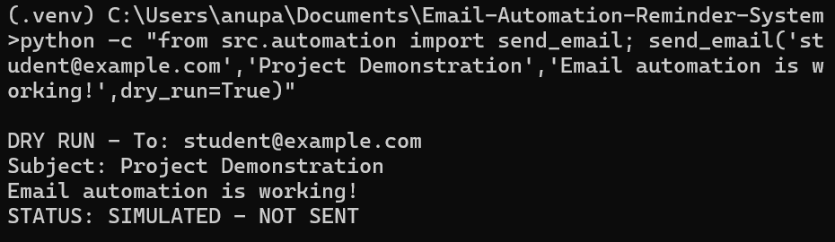

# Email Automation \& Reminder System


A Python-based automation project that processes scheduled reminders, generates personalized emails, and tracks communication activity.


## Project Overview


This project demonstrates how Python can automate repetitive email and reminder workflows.


## Key Features


* Contact management using CSV files
* Personalized email generation
* Reminder scheduling
* Safe email simulation (dry-run mode)
* SMTP email functionality
* Duplicate reminder prevention
* Activity logging
* CSV report generation


## Technologies Used


* Python
* Pandas
* Schedule
* smtplib
* email.message
* python-dotenv
* CSV
* Git and GitHub


## Current Project Status


The simulation workflow has been successfully tested.


Real SMTP email delivery is optional and has not yet been verified.                 

&#x20;                                                                         ## Installation


1\. Clone the repository.

2\. Open the project folder.

3\. Create a Python virtual environment:


```cmd

python -m venv .venv

```


4\. Activate the environment on Windows:


```cmd

.venv\\Scripts\\activate

```


5\. Install the required dependencies:


```cmd

python -m pip install -r requirements.txt

```


## How to Run


Preview personalized emails:


```cmd

python -m src.automation

```


Start the reminder scheduler:


```cmd

python main.py

```


Run the safe email simulation:


```cmd

python -c "from src.automation import simulate\_due\_emails; simulate\_due\_emails()"

```


## Email Configuration


Copy `.env.example` to `.env` and replace the placeholder values with your own SMTP configuration.


Never commit `.env` or real passwords to GitHub.


The tested simulation runs without SMTP credentials. Live SMTP delivery has not yet been verified.


## Example Simulation Output


```text

SKIPPED: R001 already processed

SKIPPED: R002 already processed

SKIPPED: R003 already processed


DRY RUN - To: asha@example.com

Subject: Reminder - Final Integration Test

STATUS: SIMULATED - NOT SENT


Report: outputs/email\_report.csv

Simulation completed. No emails were sent.

```


## Project Outputs


\- Personalized email previews

\- Reminder scheduling checks

\- Simulated email status records

\- CSV reports

\- Timestamped activity logs

\- Duplicate-processing prevention

## Screenshots




# Email Automation & Reminder System

A Python-based automation project that processes scheduled reminders, generates personalized emails, and tracks reminder activity.

## Project Overview

This project demonstrates how Python can automate repetitive email and reminder workflows using CSV data, reusable email templates, scheduling, and execution reports.

The system supports safe email simulations and includes optional SMTP email functionality.

## Key Features

- Contact and reminder management using CSV files
- Personalized email generation
- Reminder scheduling and due-date checking
- Safe email simulation (dry-run mode)
- Optional SMTP email integration
- Duplicate-reminder prevention
- Activity logging
- CSV report generation
- Automated unit testing

## Technologies Used

- Python
- Pandas
- Schedule
- smtplib
- email.message
- python-dotenv
- CSV
- Unittest
- Git and GitHub

## Installation

**1. Clone the repository**

```cmd
git clone https://github.com/anupampeternetto-alt/Email-Automation-Reminder-System.git
```

**2. Open the project folder**

```cmd
cd Email-Automation-Reminder-System
```

**3. Create a virtual environment**

```cmd
python -m venv .venv
```

**4. Activate the virtual environment on Windows**

```cmd
.venv\Scripts\activate
```

**5. Install the dependencies**

```cmd
python -m pip install -r requirements.txt
```

## How to Run

**Preview personalized emails**

```cmd
python -m src.automation
```

**Start the reminder scheduler**

```cmd
python main.py
```

Press `Ctrl + C` to stop the scheduler.

**Run the safe email simulation**

```cmd
python -c "from src.automation import simulate_due_emails; simulate_due_emails()"
```

The simulation processes due reminders, skips previously simulated reminders, and saves results to `outputs/email_report.csv`.

**Run automated tests**

```cmd
python -m unittest discover -s tests -v
```

The project has successfully passed all nine automated tests.

## Email Configuration

Copy `.env.example` to `.env` and replace the example values with your own SMTP configuration.

Never commit `.env` or actual passwords to GitHub.

The tested simulation runs without SMTP credentials. Live SMTP delivery has not yet been verified.

## Example Simulation Output

```text
SKIPPED: R001 already processed
SKIPPED: R002 already processed
SKIPPED: R003 already processed

DRY RUN - To: asha@example.com
Subject: Reminder - Final Integration Test
STATUS: SIMULATED - NOT SENT

Report: outputs/email_report.csv
Simulation completed. No emails were sent.
```

*This is an example from the tested simulation. Results may differ depending on previously processed reminders.*

## Project Outputs

- Personalized email previews
- Reminder scheduling checks
- Simulated email status records
- CSV execution reports
- Timestamped activity logs
- Duplicate-processing prevention

## Project Screenshot


## Testing

Nine automated tests validate the presence of essential project files, email personalization, safe dry-run behavior, and duplicate-reminder prevention.

**Test result:** 9 tests passed.

## Current Project Status

The project is complete as a tested Python automation portfolio demonstration.

Real SMTP email delivery is optional and has not yet been verified.

## Learning Outcomes

This project demonstrates Python programming, CSV processing, email personalization, local scheduling, SMTP integration, error handling, logging, automated testing, and Git version control.